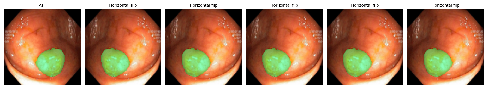
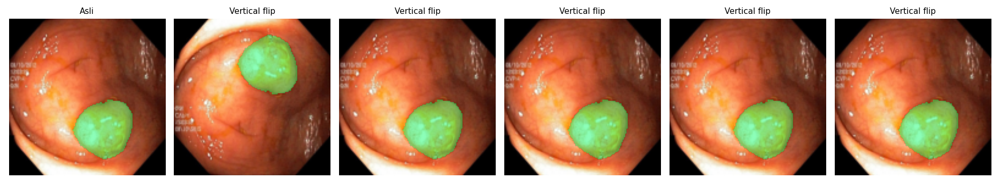
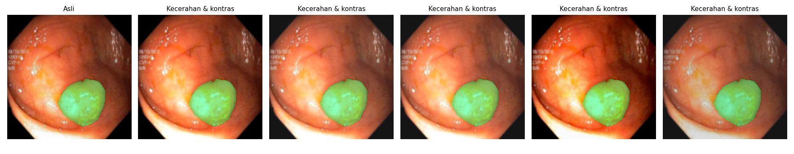
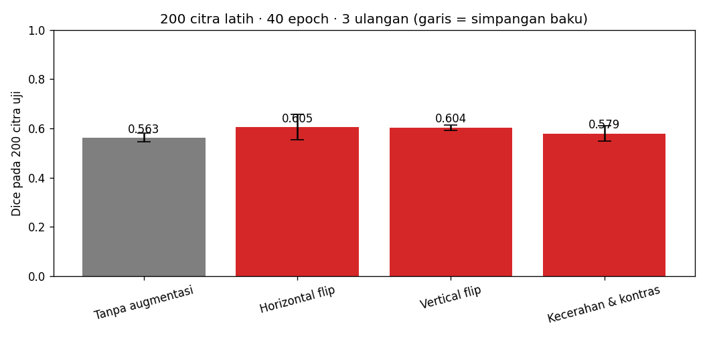
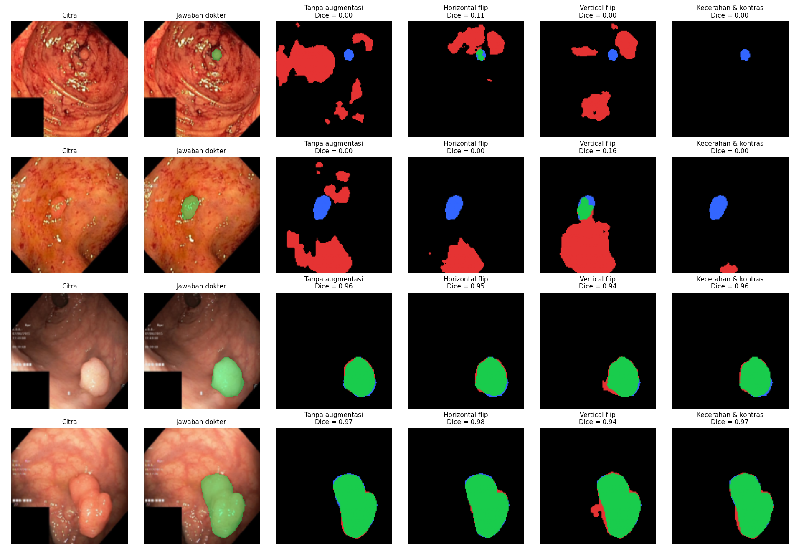

# Segmentasi Polip pada Citra Kolonoskopi dengan U-Net

<!--
  TEMPLATE LAPORAN — Tugas P10 Kecerdasan Buatan (BM25-41204), Teknik Biomedis ITERA.
  Petunjuk lengkap: https://mctm.web.id/ai-bm/tugas

  Cara memakai:
  - Ganti semua teks yang diawali "✍️" dengan tulisan kelompokmu, lalu hapus tanda ✍️-nya.
  - Blok komentar seperti ini adalah petunjuk; tidak tampil di GitHub. Boleh dihapus.
  - Gambar diambil dari folder hasil/ yang dibuat otomatis oleh notebook.
  - Jangan hapus judul-judul bagian (##).
-->

**Tugas P10 — Kecerdasan Buatan (BM25-41204), Teknik Biomedis ITERA**

## Anggota kelompok

| Nama | NIM | Username GitHub | Kontribusi utama |
|---|---|---|---|
| Adelya Dwi Putri | 123430034 | adelyiinann | Ketua kelompok, menyiapkan persiapan, membuat repo, menjalankan eksperimen di colab, commit hasil akhir |
| Izzatul Jannah | 123430120 | izzatul.123430120-code | Menulis hipotesis Bagian 3, analisis Bagian 5, pembahasan Bagian 6 |

## 1. Pertanyaan

Augmentasi apa yang membantu U-Net menemukan polip pada citra kolonoskopi, dan augmentasi apa yang tidak? Kenapa?

## 2. Data & pengaturan

- Dataset: Kvasir-SEG (1000 citra kolonoskopi + mask polip), diperkecil ke 128 × 128 piksel.
- Data uji: 200 citra (tetap). Data latih: 200 citra per ulangan, dipilih dari kumpulan 800 citra di luar data uji.
- Model: U-Net mini (`k=16`), 40 epoch, 3 ulangan per skenario; `CEPAT = False`.
- Dijalankan di: GPU CUDA (metadata notebook mencatat Google Colab T4). Output tersimpan mencatat waktu sekitar 4,2 menit.
- Pembagian uji memakai seed 0; subset latih dan bobot awal disamakan antarskenario pada setiap ulangan (seed 0, 1, 2).
- Adam (`lr=0.001`), batch 16, loss BCE-with-logits + Dice loss, ambang prediksi > 0,5.
- Dice/IoU dirata-ratakan per citra pada 200 citra uji; simpangan baku antarulangan memakai `ddof=0`, sesuai notebook.


## 3. Skenario augmentasi & hipotesis


| Skenario | Augmentasi (kode) | Alasan klinis | Hipotesis: Dice naik/turun/sama? |
|---|---|---|---|
| Tanpa augmentasi | — | Pembanding | — |
| Horizontal flip | `v2.RandomHorizontalFlip()` | Polip dapat muncul di sisi kiri maupun kanan lumen usus, sehingga model perlu tidak bias terhadap orientasi horizontal | Naik: variasi orientasi membantu generalisasi |
| Vertical flip | `v2.RandomVerticalFlip()` | Sudut masuk endoskop bervariasi sehingga posisi atas-bawah polip tidak selalu konsisten | Naik: alasan serupa dengan horizontal flip |
| Brightness & contrast | `v2.ColorJitter(brightness=0.3, contrast=0.3)` | Intensitas cahaya endoskop tidak merata dan berubah tergantung jarak kamera ke dinding usus | Naik: model lebih tahan terhadap variasi pencahayaan |

Contoh augmentasi yang dicoba:








## 4. Hasil

Sumber: [hasil.json](hasil/hasil.json), sesuai output notebook tersimpan.

| Skenario | Dice (rata-rata ± sb) | IoU (rata-rata ± sb) | Dice tiap ulangan |
|---|---|---|---|
| Tanpa augmentasi | 0.563 ± 0.018 | 0.450 ± 0.016 | 0.557, 0.587, 0.544 |
| Horizontal flip | 0.605 ± 0.052 | 0.502 ± 0.045 | 0.625, 0.657, 0.535 |
| Vertical flip | 0.604 ± 0.011 | 0.480 ± 0.013 | 0.593, 0.600, 0.619 |
| Kecerahan & kontras | 0.579 ± 0.031 | 0.466 ± 0.033 | 0.590, 0.538, 0.611 |



## 5. Analisis peta kesalahan



<!-- Hijau = benar, merah = false positive, biru = false negative.
     Pertanyaan pemandu: Polip seperti apa yang sering terlewat (kecil? datar? warna mirip dinding usus?)
     Apa yang sering dikira polip padahal bukan? Apakah augmentasi memperbaiki kasus sulit? -->

Peta kesalahan menunjukkan bahwa kemampuan model U-Net dalam melakukan segmentasi polip berbeda pada setiap citra uji. Pada dua citra yang paling sulit dikenali, model masih menghasilkan kesalahan berupa false positive dan false negative. Kesalahan tersebut terlihat dari area berwarna merah yang menunjukkan bagian bukan polip tetapi diprediksi sebagai polip, serta area biru yang menunjukkan bagian polip yang tidak berhasil terdeteksi.

Penggunaan augmentasi belum sepenuhnya mengatasi kesalahan pada kedua citra tersebut. Horizontal flip menghasilkan Dice Score sebesar 0,11 pada citra pertama, sedangkan vertical flip menghasilkan Dice Score sebesar 0,16 pada citra kedua. Sementara itu, skenario tanpa augmentasi dan kecerahan serta kontras memperoleh Dice Score 0,00 pada kedua citra. Hal ini menunjukkan bahwa perubahan orientasi gambar dapat membantu model pada beberapa kasus, tetapi belum mampu meningkatkan hasil segmentasi secara konsisten pada citra yang sulit.

Berbeda dengan dua citra tersebut, dua citra uji yang paling mudah dikenali menunjukkan hasil segmentasi yang lebih baik. Seluruh skenario menghasilkan Dice Score pada rentang 0,94 hingga 0,98. Hal ini menunjukkan bahwa model mampu melakukan segmentasi dengan baik pada citra yang karakteristik polipnya lebih mudah dikenali.

Secara keseluruhan, peta kesalahan memperlihatkan bahwa tingkat keberhasilan segmentasi dipengaruhi oleh karakteristik citra dan kemampuan model dalam membedakan area polip dari jaringan di sekitarnya. Augmentasi dapat memberikan perbaikan pada kondisi tertentu, tetapi tidak selalu mampu mengatasi kesalahan pada citra yang memiliki tingkat kesulitan tinggi.

## 6. Pembahasan & kesimpulan

<!-- Bandingkan hasil dengan hipotesis di Bagian 3. Hipotesis yang ternyata salah tetap bernilai,
     asalkan dijelaskan kenapa. Perbedaan kecil (lebih kecil dari simpangan baku) belum tentu berarti. -->

Berdasarkan hasil eksperimen, seluruh skenario augmentasi menghasilkan nilai Dice Score dan IoU rata-rata yang lebih tinggi dibandingkan skenario tanpa augmentasi. Skenario horizontal flip memperoleh Dice Score tertinggi sebesar 0,605 ± 0,052 dan IoU sebesar 0,502 ± 0,045. Hasil ini menunjukkan bahwa augmentasi horizontal flip memberikan performa rata-rata terbaik dalam eksperimen yang dilakukan.

Skenario vertical flip menghasilkan Dice Score sebesar 0,604 ± 0,011 dan IoU sebesar 0,480 ± 0,013. Nilai Dice Score tersebut hampir sama dengan skenario horizontal flip, tetapi memiliki simpangan baku yang lebih kecil. Hal ini menunjukkan bahwa hasil pengulangan pada skenario vertical flip lebih konsisten. Sementara itu, augmentasi kecerahan dan kontras menghasilkan Dice Score sebesar 0,579 ± 0,031 dan IoU sebesar 0,466 ± 0,033. Meskipun hasilnya lebih baik dibandingkan skenario tanpa augmentasi, peningkatannya masih berada di bawah kedua skenario flip.

Perbedaan hasil tersebut menunjukkan bahwa jenis augmentasi memberikan pengaruh yang berbeda terhadap performa model U-Net dalam melakukan segmentasi polip. Namun, selisih Dice Score antara horizontal flip dan vertical flip hanya sebesar 0,001. Oleh karena itu, nilai rata-rata yang lebih tinggi pada horizontal flip belum cukup untuk menyatakan bahwa skenario tersebut secara nyata lebih unggul. Hasil ini perlu dipahami berdasarkan nilai rata-rata dan variasi dari setiap pengulangan.

Secara keseluruhan, augmentasi dapat membantu meningkatkan performa model U-Net pada eksperimen segmentasi polip yang dilakukan. Skenario horizontal flip memperoleh nilai rata-rata Dice Score dan IoU tertinggi, sedangkan vertical flip menunjukkan variasi hasil Dice Score yang lebih kecil. Dengan demikian, pemilihan augmentasi perlu mempertimbangkan tidak hanya nilai performa rata-rata, tetapi juga konsistensi hasil pengujian.

Hipotesis kenaikan Dice sesuai dengan arah rata-rata ketiga skenario, tetapi tidak berlaku pada setiap ulangan. Horizontal flip lebih rendah daripada pembanding pada ulangan ketiga (0,535 vs 0,544), dan kecerahan & kontras lebih rendah pada ulangan kedua (0,538 vs 0,587). Kenaikan rata-rata kecerahan & kontras sekitar 0,017, lebih kecil daripada simpangan bakunya 0,031. Tidak ada uji signifikansi, sehingga hasil ini bersifat deskriptif dan tidak membuktikan bahwa salah satu augmentasi selalu membantu.

Batas eksperimen: hanya tiga ulangan, 200 citra latih per ulangan, resolusi 128 × 128, dan satu pembagian uji tetap. Hasil belum menunjukkan generalisasi ke rumah sakit lain. Bobot awal dan subset latih disamakan, tetapi augmentasi mengonsumsi bilangan acak sehingga urutan batch pada epoch berikutnya tidak dijamin identik antarskenario. Seluruh selisih hasil tidak dapat diatribusikan secara pasti hanya kepada augmentasi.

## 7. Pembagian kerja

- **Adelya Dwi Putri:** persiapan tugas, pembuatan repo, menjalankan eksperimen dan kode.
- **Izzatul Jannah:** analisis hasil eksperimen dan pembahasan.


## 8. Penggunaan AI

- Claude (claude.ai) dipakai untuk memandu langkah pengerjaan git dan Colab, menentukan skenario augmentasi, dan membantu merapikan narasi README. Analisis hasil dan kesimpulan di Bagian 6 ditulis sendiri lalu dirapikan dengan bantuan AI.
- Codex CLI untuk memeriksa kesesuaian hasil eksperimen dengan output notebook, melengkapi pengaturan dan tabel hasil pada README, serta merapikan draf analisis dan pembahasan yang telah dibuat. Codex juga membantu menjelaskan keterbatasan interpretasi hasil. Eksperimen telah dijalankan oleh anggota kelompok sebelum sesi bantuan ini.

## Cara menjalankan ulang

```bash
uv sync
uv run jupyter lab segmentasi_polip.ipynb
```

Atau buka notebook di Google Colab (Runtime → Change runtime type → T4 GPU).

## Referensi

- Jha, D., dkk. (2020). Kvasir-SEG: A Segmented Polyp Dataset. *MultiMedia Modeling (MMM 2020)*, 451–462.
- Ronneberger, O., Fischer, P., & Brox, T. (2015). U-Net: Convolutional Networks for Biomedical Image Segmentation. *MICCAI*. arXiv:1505.04597.
- Petunjuk tugas: https://www.mctm.web.id/ai-bm/tugas
